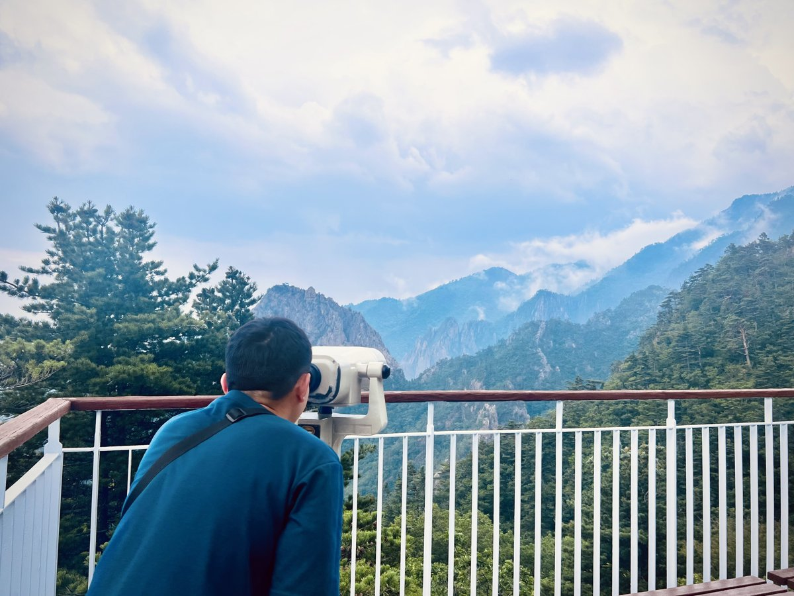

::: {.columns}

::: {.column width="52%"}
Hi! I’m a macroeconomist specializing in economic inequality and development. I’m also interested in the macroeconomic implications of education and human capital formation, especially how they shape inequality and mobility.

I have worked extensively on how Covid will affect economic inequality. Recently I have started working on family's roles in economic development and efficient policies for redistribution.
:::

::: {.column width="3%"}
:::

::: {.column width="45%"}
{width=100%}
:::

:::

## News
