We have been cranking out German social security records to understand the transformation of the East German labor market. Despite two decades of stagnation, wage growth in the first few years after reunification was spectacular:

::: {.figure .text-center}
::: columns
::: {.column width="25%"}
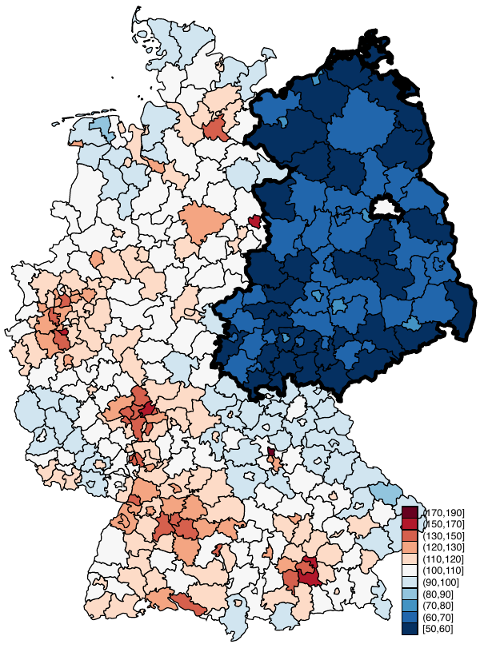

1992

:::

::: {.column width="25%"}
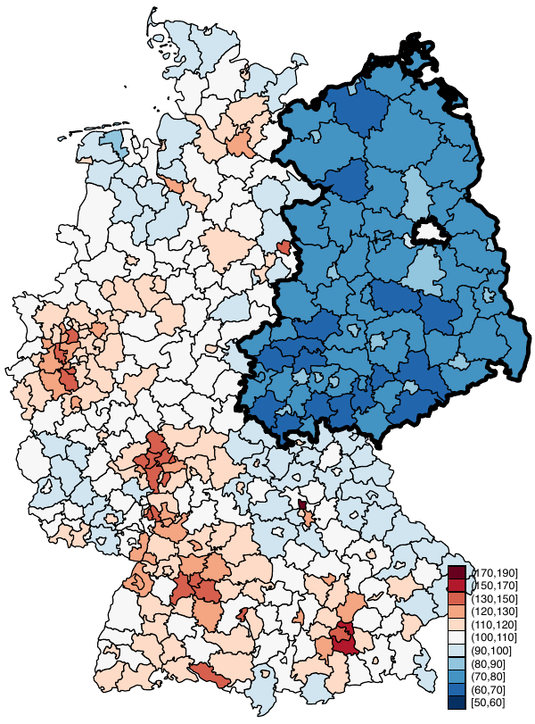

1995

:::

::: {.column width="25%"}
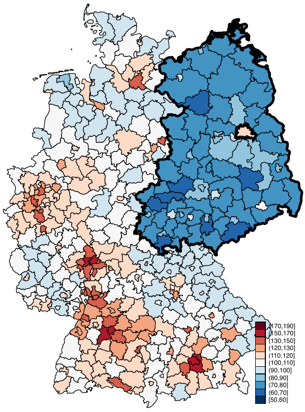

2000

:::

::: {.column width="25%"}
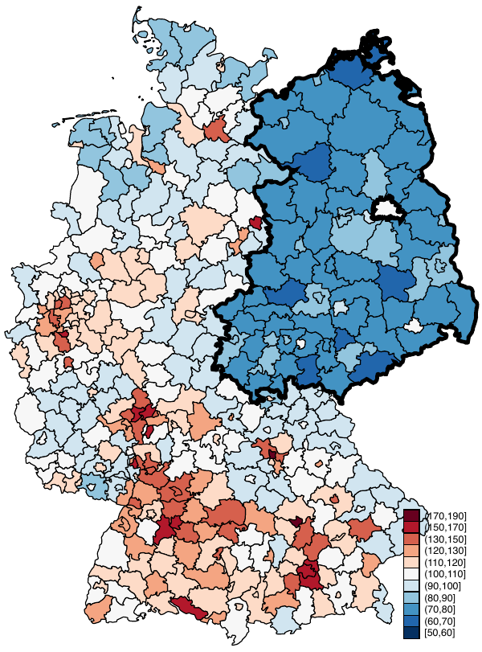

2013

:::
:::

Average wages in Germany. White is average, blue is less, red is more.

:::

The popular conception is that East Germans gained mostly from migrating West, but the patterns are clear that most of the growth came from **within** East (robust to painstaking checks). Another widespread conception is that East Germany was supposed to continue to grow to West German levels (they went from less than half to about two thirds in 5 years, then got stuck there), so the last two decades of stagnation mean something is going wrong.

But maybe slow growth is the natural outcome. Then the question becomes, why did wages grow so rapidly in the beginning?

We posit that, in a setting where West institutions were almost perfectly superimposed on the East, labor market adjustment seems to have followed immediately---despite other fundamental differences that may exist between East and West German workers and firms (which is probably why they stopped growing). 

How did we come to this conclusion? Well, the first few years post-reunification also involved a lot of workers switching jobs...

::: {.figure .text-center}
::: columns
::: {.column width="25%"}
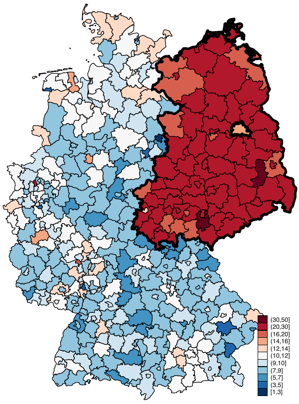

1992

:::

::: {.column width="25%"}
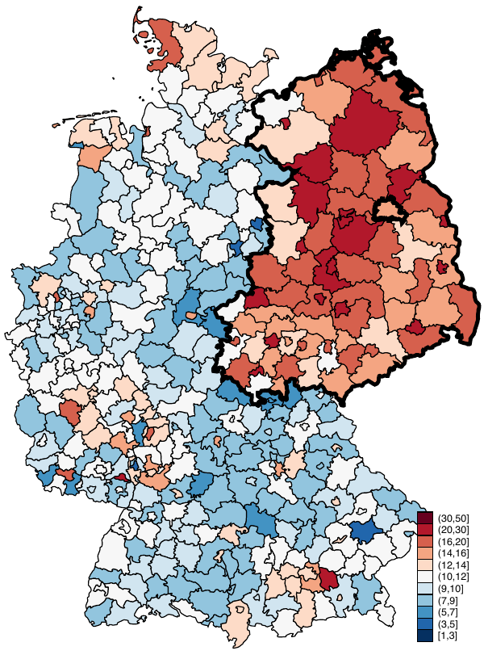

1995

:::

::: {.column width="25%"}
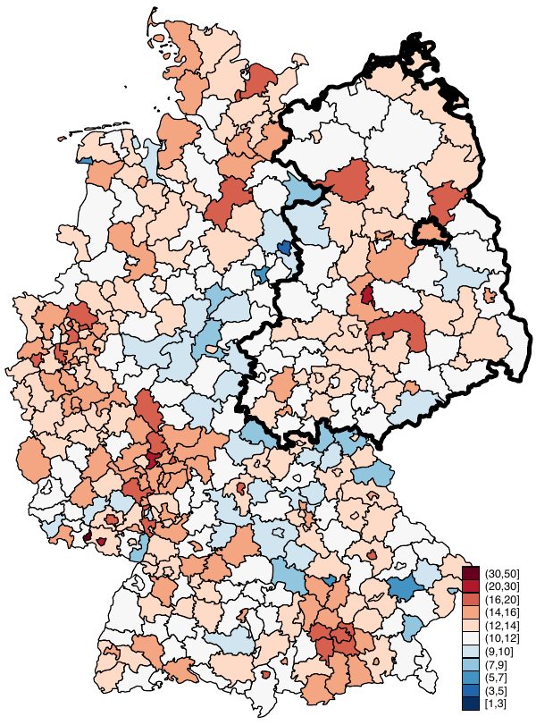

2000

:::

::: {.column width="25%"}
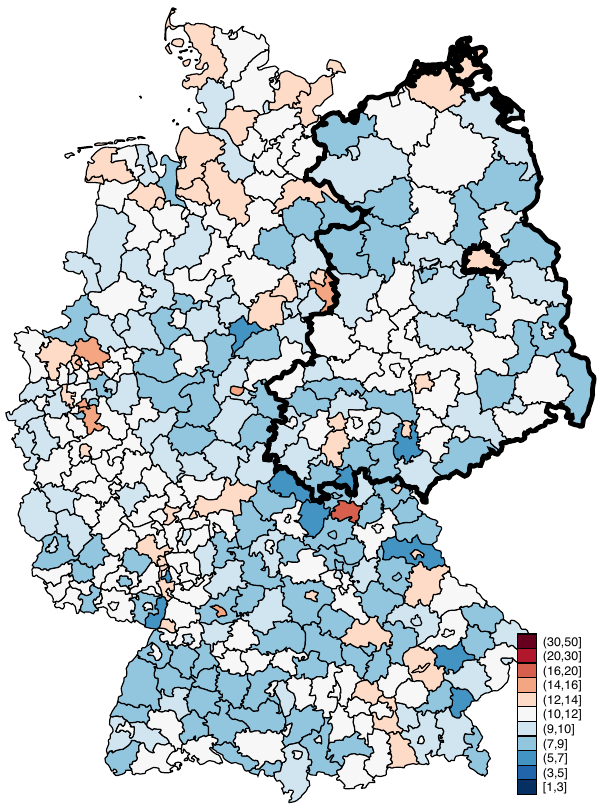

2013

:::
:::

Between-firm job switches in Germany. White is average, blue is less, red is more.

:::

and lots of firm restructuring, both *extensive* (change in size) and *intensive* (change in workforce):

::: {.figure .text-center}
::: columns
::: {.column width="50%"}
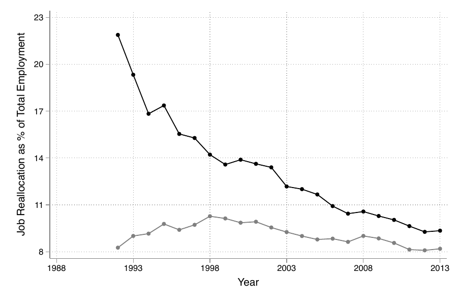

Job Reallocation

:::

::: {.column width="50%"}
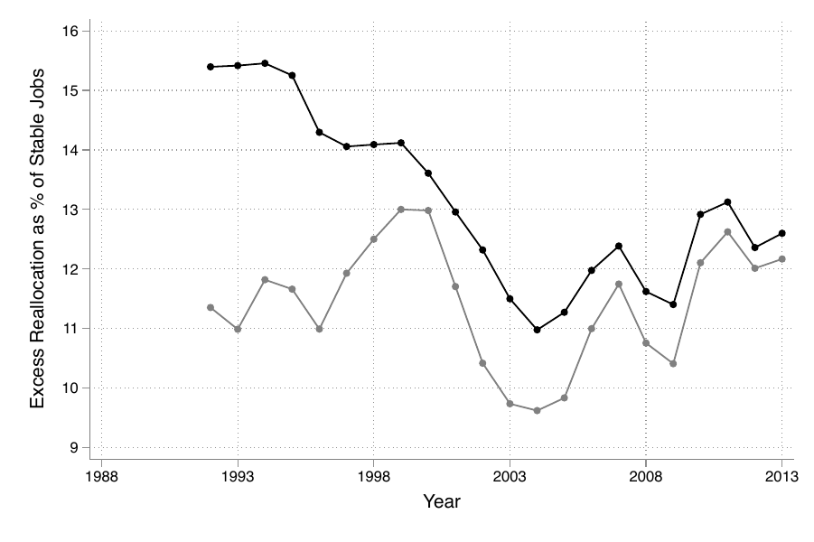

Excess Worker Reallocation

:::
:::

**Left:** Job Creation and Destruction. **Right:** Share of swapped workers without changing firm size. East in black.

:::

Job reallocation in year $t$ is defined as
$$
    JR_t = \frac{
    \sum_{j\in\mathcal I}|N_{j,t+1}-N_{j,t}|
     + \sum_{j\in\mathcal{N}_{t+1}}N_{j,t+1}
     + \sum_{j\in\mathcal{N}_t}N_{j,t}
     }
    {\sum_j\left(N_{j,t}+N_{j,t+1}\right)}, 
$$

where $N_j$ is the employment size of firm $j$, $\mathcal{I}$ is the set of incumbent firms (that are in existence in both $t$ and $t+1$), and $\mathcal{N}_t$ the set of firms in existence only in year $t$. So job reallocation captures the following: Among all jobs in the economy, how many involved a change in firm size, or firm entry or exit? 

Then we can also define **excess worker reallocation** as

$$
    EWR_t = \frac{
    H_t + F_t - JR_t\cdot\sum_j\left(N_{j,t}+N_{j,t+1}\right)
     }
    {\min\{N_{j,t},N_{j,t+1}\}}.
$$

where $H_t$ and $F_t$ are the total number of hires and fires, respectively. Think of it like this: Among all hires and fires in the economy, how many workers were swapped without involving a change in firm size?

You might say, those are just time series, and wage growth and reallocation are spuriously correlated. Or, higher productivity and/or union regulations injected from the West just incentivized firms and workers to reallocate more.

We want to show that reallocation was an outcome of institutional transformation, and must surely have contributed to wage growth. 

## The Cohort-Reallocation Gradient

Take yourself back to 1990 and imagine who is more likely to switch jobs, or to get fired and forced to find a new job---the old man who worked in a communist factory for decades, or the 20 year-old who just started a new career in a new Germany? The answer is clear in the data:

::: {.figure .text-center}
::: columns
::: {.column width="100%"}
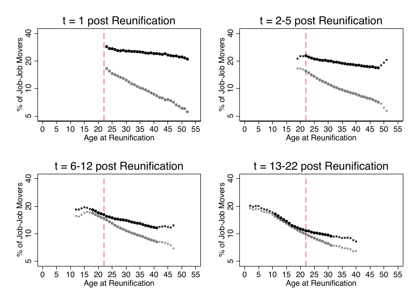
:::
:::

Between-firm job switches by cohort. East in black.

:::

In just 5 years, East Germans who started their careers after reunification don't switch jobs any more than their West German counterparts. More surprisingly, East Germans who started their careers before reunification are still switching jobs relatively more often.

## Firms before and after Reunification

By the same token, it was old firms that did most of the restructuring, and still are. Surprisingly, new East and West firms that entered after reunification look almost the same from the get-go!

::: {.figure .text-center}
::: columns
::: {.column width="100%"}
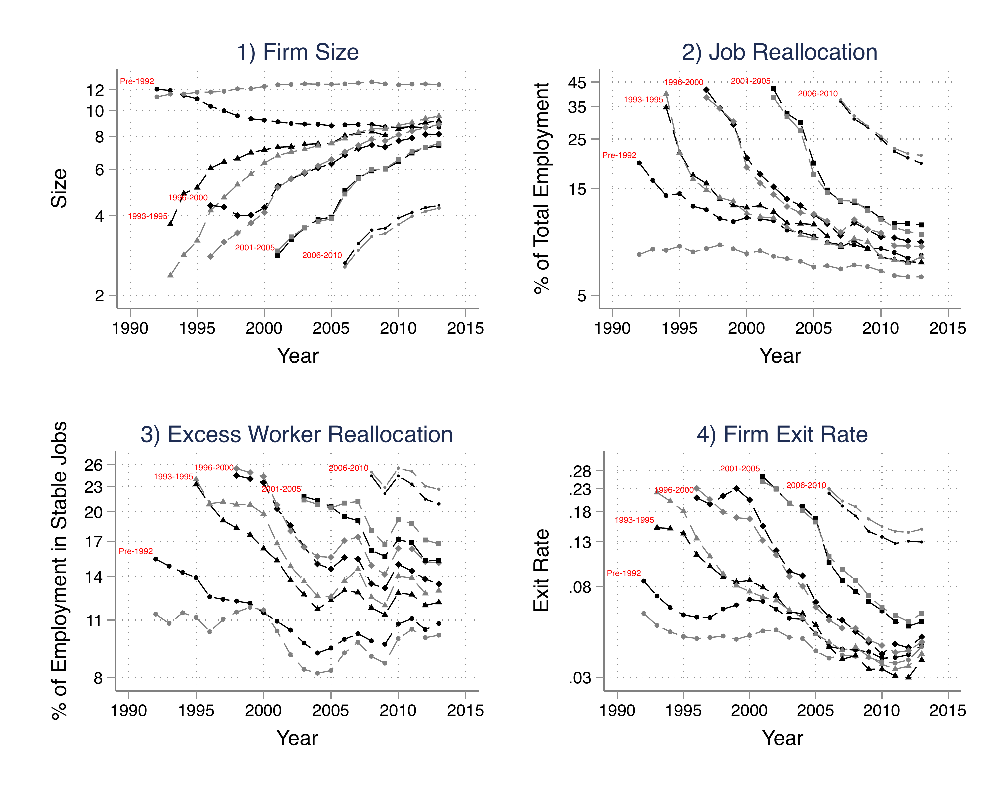
:::
:::

Firm reallocations over time, by cohort. East in black.

:::

## What else do we do?

It would be nice to show that the reallocation patterns caused wage growth. We do a lot of extra empirical stuff that backs this up, but after all it is impossible to relate average wage growth *over time* to reallocation patterns across worker and firm cohorts *at a given moment in time*---moreover, wage growth would stem from both the worker- and firm-sides, so we need a framework to incorporate them simultaneously. 

Which led us to build a beautiful model of multi-worker firms with hetergeoenous worker matches, endogenous firing and on-the-job search by workers who age over their life-cycle.

## Results coming soon!